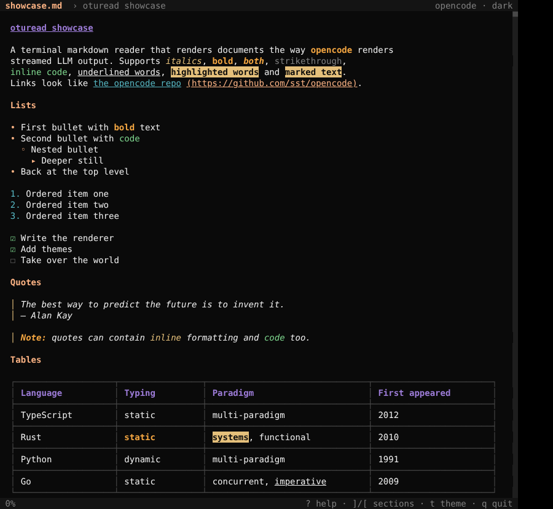
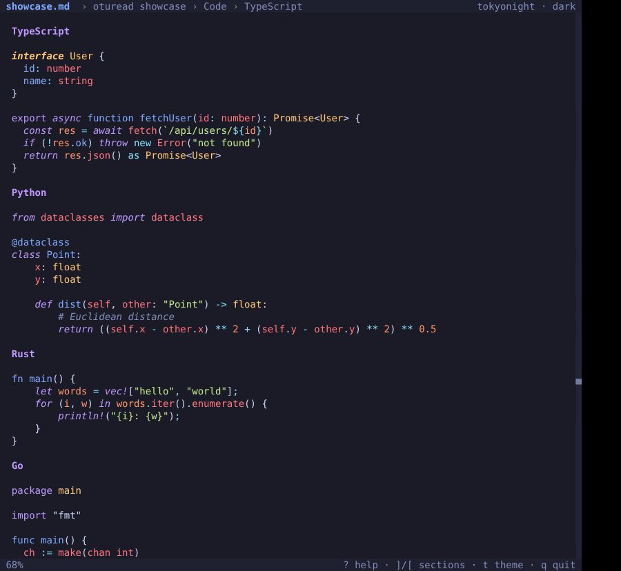

# oturead

A terminal markdown reader that renders documents the same way
[opencode](https://github.com/sst/opencode) renders streamed LLM output.



It uses the same building blocks as opencode's TUI:
[OpenTUI](https://github.com/sst/opentui)'s `MarkdownRenderable` in
`top-level` block mode, opencode's tree-sitter grammar list, opencode's syntax
style rules, and opencode's themes.

## Features

- **Syntax highlighting** for about 35 languages via tree-sitter: TypeScript,
  JavaScript, Python, Rust, Go, C, C++, C#, Java, Kotlin, Ruby, PHP, Scala,
  Bash, Lua, Haskell, OCaml, Elixir, Julia, Clojure, Nix, HCL, JSON, YAML,
  TOML, HTML, CSS, XML, Vue, Make, Vim, R, F#, Zig, diff, and more. Grammars
  download on first use and are cached in `~/.local/share/opentui`.
- **Tables** span the full width in a boxed grid, with inline formatting
  inside cells.
- **Heading colours by level**: H1 is bold and underlined, and H2 through H6
  each get their own colour. A breadcrumb in the title bar shows which
  section you're reading.
- **Lists**: a different bullet at each nesting depth (`•` `◦` `▸`), coloured
  numbers, and `☐`/`☑` task checkboxes.
- **Blockquotes** have a coloured bar and italic text.
- **Inline styles**: bold, italic, strikethrough, `code`, links, `<u>underline</u>`
  / `<ins>`, and `==highlight==` / `<mark>`.
- **Streaming**: pipe an LLM's output straight in and watch it render live,
  the way opencode does.
- A **scrollbar** on the right edge, plus mouse wheel scrolling and
  select-to-copy over OSC 52, which works over SSH.
- **33 themes** (opencode, tokyonight, catppuccin, gruvbox, nord, dracula, …)
  in dark and light. Any opencode theme JSON works.



## Install

You need [Bun](https://bun.sh) and a truecolor terminal (kitty, ghostty,
WezTerm, Alacritty, foot, …).

```bash
bun install
bun run src/index.tsx examples/showcase.md

# or build a standalone binary
bun run build            # -> dist/oturead
cp dist/oturead ~/.local/bin/
```

## Usage

```bash
oturead README.md                    # read a file
oturead -w notes.md                  # re-render whenever the file changes
llm "explain monads" | oturead       # render streamed LLM output live
oturead -s examples/showcase.md      # replay a file as if an LLM were streaming it
oturead -s 1500 doc.md               # ...at 1500 chars/sec
oturead -t tokyonight -l doc.md      # pick a theme, light variant
oturead --list-themes
```

You can also set a default theme with the `OTUREAD_THEME` environment variable.

### Editing

Press `e` to open the file in your editor at the line at the top of the
screen. oturead checks `$VISUAL`, then `$EDITOR`, and falls back to `vi`. It
passes the line the way each editor expects: `+LINE` for vi, vim, nvim, nano,
emacs, micro, kak and others; `FILE:LINE` for helix; and `--wait --goto` for
VS Code, Cursor and similar. When the editor exits, oturead reloads the file
and scrolls back to the same place.

### Keys

| Key                     | Action                         |
|-------------------------|--------------------------------|
| `j` / `k`, `↓` / `↑`    | scroll one line                |
| `d` / `u`               | half page down / up            |
| `space` / `b`, PgDn/PgUp| full page down / up            |
| `g` / `G`, Home/End     | top / bottom                   |
| `]` / `[`, `n` / `p`    | next / previous heading        |
| `e`                     | edit the file in `$VISUAL` / `$EDITOR` at the line you're reading; returns there when you quit the editor |
| `t`                     | theme picker: type to fuzzy-search, ↑/↓ to preview live, Enter to apply, Esc to revert |
| `m`                     | toggle dark / light            |
| `r`                     | toggle rendered / raw markdown |
| mouse drag              | select text and copy it        |
| `?`                     | help                           |
| `q`, `Ctrl+C`           | quit                           |

## Custom themes

Put opencode-format theme files (`*.json`) in `~/.config/oturead/themes/`.
Themes in `~/.config/opencode/themes/` are picked up too.

## How it works

| File                   | Purpose |
|------------------------|---------|
| `src/index.tsx`        | CLI: parses arguments, picks the source (file, watch, stdin, or simulated stream), registers the tree-sitter grammars. When stdin is a pipe, keyboard input is read from `/dev/tty`. |
| `src/App.tsx`          | The UI: title bar with breadcrumb, a scrollbox around `<markdown>`, status bar, help overlay, and key bindings. |
| `src/theme.ts`         | Resolves opencode v1 themes and builds the tree-sitter style table (based on opencode's `syntax.ts`). |
| `src/markdown-ext.ts`  | Small additions to OpenTUI's `MarkdownRenderable`: underline and highlight, bullet and checkbox markers, quote bar colour. |
| `src/parsers-config.ts`| The tree-sitter grammar list from opencode, plus extra fence aliases (`shell`, `golang`, `tf`, `jsonc`, …). |
| `src/themes/`          | The bundled opencode themes. |
| `scripts/snapshot.tsx` | Renders a file headlessly to HTML; used for the screenshots above. |

## Credits

The themes and the tree-sitter grammar configuration come from
[opencode](https://github.com/sst/opencode), which is MIT licensed.
